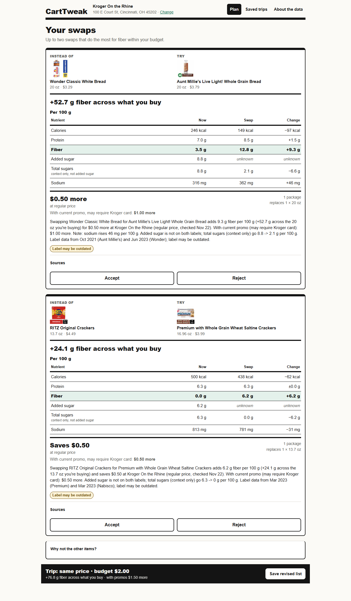

# CartTweak

**Grocery swaps that fit your nutrition goals and your budget.**

CartTweak takes a shopping list or receipt and suggests up to two swaps for your next grocery trip. Pick a store, set a budget for the whole trip, and aim for more fiber or protein, or less added sugar or sodium.

## What you can do

- **Start with what you buy.** Paste a list, try the demo list, or scan a Walmart receipt. Receipt photos are processed in your browser.
- **See the trade-offs.** Compare nutrition per 100 g or 100 mL and see the checkout difference based on whole packages. Promotions are shown separately.
- **Keep the swaps you like.** Accept or skip suggestions and save your trip in your browser.

## Run locally

1. Install dependencies with `npm ci` using Node.js 22.12 or later.
2. Copy `.env.example` to `.env`. For live planning, set `KROGER_CLIENT_ID`, `KROGER_CLIENT_SECRET`, and `FDC_API_KEY`. The Kroger app needs the `product.compact` scope.
3. Run `npm run dev` and open [CartTweak on localhost](http://localhost:5173).

Run `npm test` for the Vitest suite and `npm run typecheck` for TypeScript checks.

## How it works

Kroger supplies store-specific prices and package sizes. CartTweak matches USDA FoodData Central nutrition records by barcode. The React app lives in `web/`, the Hono API in `server/`, and the swap engine in `shared/`.

[Data sources and coverage](docs/DATA_SOURCES.md) · [Design decisions](docs/DECISIONS.md) · [Sample receipt](docs/samples/sample-receipt.png)
